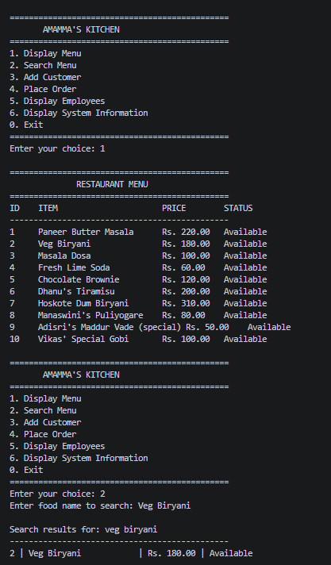
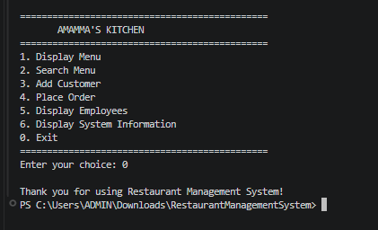

# 🍽️ Restaurant Management System

A console-based **Restaurant Management System developed using Java**.

This project demonstrates important Object-Oriented Programming (OOP) concepts such as **encapsulation, inheritance, polymorphism, abstraction, interfaces, method overloading, method overriding, static members, enums, and packages**.

---

## 📁 Project Structure

```text
RestaurantManagementSystem/
├── app/
│   └── Main.java
├── model/
│   ├── Chef.java
│   ├── Customer.java
│   ├── Employee.java
│   ├── MenuItem.java
│   ├── Order.java
│   ├── OrderStatus.java
│   ├── Payable.java
│   └── Person.java
├── service/
│   └── RestaurantService.java
├── .gitignore
├── Display_Menu.png
├── Exit.png
├── Opt 3&4.png
├── Opt 5&6.png
└── README.md
```

---

## 🏗️ System Architecture Diagram


[View Interactive GitDiagram](https://gitdiagram.com/dhanush-143-kk/restaurantmanagementsystem)

## 📌 Project Overview

The Restaurant Management System is a Java console application designed to manage basic restaurant operations.

The system allows users to:

- Display the restaurant menu
- Search for food items
- Add new customers
- Place orders
- Display employees
- Calculate order bills
- Manage order status
- Display system information

The project follows a simple **App → Service → Model** architecture.

---

## 🎯 Objectives

1. To develop a console-based restaurant management application using Java.
2. To implement Object-Oriented Programming concepts.
3. To manage restaurant menu items.
4. To manage customer information.
5. To manage employee information.
6. To implement order creation and processing.
7. To calculate bills using an interface.
8. To demonstrate inheritance and polymorphism.
9. To demonstrate Java packages and modular project organization.
10. To provide a simple and user-friendly console interface.

---

## 🛠️ Technologies Used

- **Programming Language:** Java
- **JDK:** Java 27
- **IDE:** Visual Studio Code
- **Version Control:** Git
- **Repository Hosting:** GitHub
- **Interface:** Console / Command Line

---

## 🏗️ Project Architecture

The project follows this architecture:

```text
App → Service → Model
```

- **App Layer:** `Main.java` handles user input and displays the console menu.
- **Service Layer:** `RestaurantService.java` handles restaurant operations.
- **Model Layer:** Contains classes representing customers, employees, menu items, orders, and other domain concepts.

---

## 🖥️ Console Output Screenshots

The following screenshots demonstrate the execution and output of the Restaurant Management System.

### 1. Display Menu

Displays the available restaurant food items, prices, and availability status.



### 2. Options 3 and 4 — Customer Management and Place Order

Demonstrates adding a customer and placing an order by selecting menu items.


### 3. Options 5 and 6 — Employee Display and System Information

Displays employee details and general information about the application.


### 4. Exit Application

Shows the console output when the user exits the Restaurant Management System.



---

## ▶️ How to Run the Project

### 1. Clone the Repository

```bash
git clone https://github.com/Dhanush-143-kk/RestaurantManagementSystem.git
```

### 2. Open the Project Folder

```bash
cd RestaurantManagementSystem
```

### 3. Compile the Java Files

Run this command in the project root:

```powershell
javac -d . app\Main.java model\*.java service\*.java
```

### 4. Run the Application

```powershell
java -cp . app.Main
```

---

## 🧠 OOP Concepts Demonstrated

- **Encapsulation:** Protecting data using private fields and controlled access.
- **Inheritance:** Reusing properties and methods from parent classes.
- **Polymorphism:** Using parent-class references and overridden methods.
- **Abstraction:** Hiding implementation details using abstract classes and interfaces.
- **Interfaces:** Using `Payable` for bill calculation.
- **Method Overloading:** Defining methods with different parameter lists.
- **Method Overriding:** Redefining inherited methods in child classes.
- **Static Members:** Sharing class-level data and methods.
- **Enums:** Representing order states using `OrderStatus`.
- **Packages:** Organizing source files into `app`, `model`, and `service`.

---

## 👨‍💻 Author

**Dhanush**

GitHub Repository: [Restaurant Management System](https://github.com/Dhanush-143-kk/RestaurantManagementSystem)

---

## 📄 Purpose

This project was developed for educational and academic purposes to demonstrate Java programming and Object-Oriented Programming concepts.
